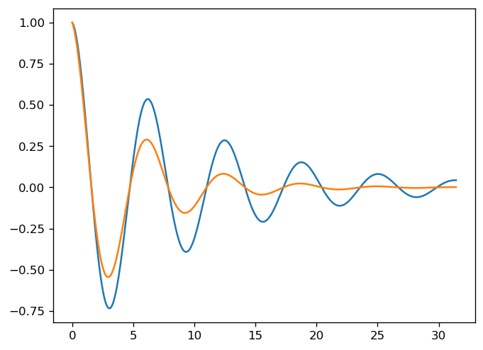
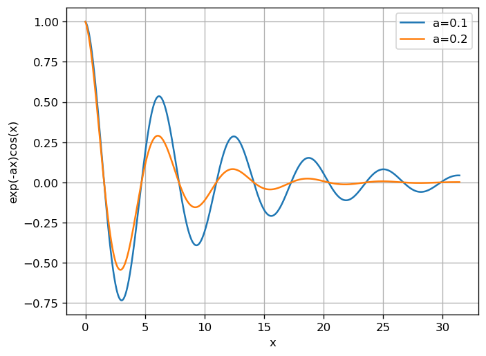

# 01. 分段函數與阻尼衰減波形 (Damped Oscillations)

## 1. 研究目的與問題背景

在土木工程與結構動力學中，結構物（如橋樑、高樓受風力或地震激振）在無外力持續補充時，其內部阻尼機制（黏滯阻尼、材料內摩擦）會使振動能量逐漸耗散，振幅隨時間呈現指數衰減。本單元之研究目的在於：
1. 掌握 Python 中條件分支邏輯與數值評估之實作方法。
2. 建立參數化指數衰減餘弦波（Damped Cosine Wave）之數學模型。
3. 透過疊加曲線與參數敏感度分析，比較不同衰減係數（$\alpha$）對振幅收斂速率之影響。
4. 建立規範化圖表要素（坐標軸標籤、圖例、格線），以符合工程資料呈現標準。

---

## 2. 對應的原始 Python 程式碼

### 2.1 分段判斷函數 (`Cell 1`)
```python
def func(x):
    if x < 0:
        return np.cos(x)
    return np.exp(-x)
print(func(-3))
print(func(8))
```

### 2.2 雙曲線初步繪圖 (`Cell 2`)
```python
import numpy as np
import matplotlib.pyplot as plt
x = np.linspace(0, 10 * np.pi, 1000)
alpha1 = 0.1
alpha2 = 0.2
y1 = np.exp(-alpha1 * x) * np.cos(x)
y2 = np.exp(-alpha2 * x) * np.cos(x)
plt.plot(x, y1)
plt.plot(x, y2)
plt.show()
```

### 2.3 參數化通用函數與標準圖表 (`Cell 3`)
```python
import numpy as np
import matplotlib.pyplot as plt
def func(x, a):
    return np.exp(-a * x) * np.cos(x)
x = np.linspace(0, 10 * np.pi, 1000)

for a in [0.1, 0.2]:
    plt.plot(x, func(x, a), label=f"a={a}")
plt.xlabel("x")
plt.ylabel("exp(-ax)cos(x)")
plt.legend()
plt.grid(True)
plt.show()
```

---

## 3. 重要函式與參數說明

- `np.linspace(0, 10 * np.pi, 1000)`：建立從 $0$ 至 $10\pi$ 之 1000 個等間距連續浮點數陣列，提供平滑繪圖之取樣點。
- `np.cos(x)` 與 `np.exp(-a * x)`：NumPy 向量化三角與指數運算函式。
- 衰減係數 $a$（或 $\alpha$）：控制指數包絡線衰減斜率之物理參數，本例選取 $a = 0.1$ 與 $a = 0.2$。
- `plt.grid(True)`：開啟背景輔助格線，有助於直觀判讀曲線振幅截距。
- `plt.legend()`：依據 `label` 參數顯示圖例，區隔不同實驗組別。

---

## 4. 相關數學公式及推導

### 4.1 分段函數數學表示
$$f(x) = \begin{cases} \cos(x), & x < 0 \\ e^{-x}, & x \ge 0 \end{cases}$$

### 4.2 單自由度系統低阻尼自由振動包絡
線性單自由度（SDOF）低阻尼自由振動位移通解為：
$$u(t) = e^{-\zeta \omega_n t} \left( A \cos(\omega_d t) + B \sin(\omega_d t) \right)$$
其中 $\zeta$ 為阻尼比，$\omega_n$ 為自然角頻率，$\omega_d = \omega_n \sqrt{1 - \zeta^2}$ 為阻尼固有頻率。
在簡化模型中，令角頻率 $\omega = 1\text{ rad/s}$，衰減率 $\alpha = \zeta \omega_n$，方程式簡化為：
$$y(x) = e^{-\alpha x} \cos(x)$$
上下包絡線為：
$$y_{\text{envelope}}(x) = \pm e^{-\alpha x}$$

當 $\alpha = 0.2$ 時，其包絡衰減速率為 $\alpha = 0.1$ 的兩倍：
$$\frac{e^{-0.2x}}{e^{-0.1x}} = e^{-0.1x}$$
隨著 $x$ 增加，$\alpha=0.2$ 的振幅迅速趨近於零。

---

## 5. 實際執行結果

### 5.1 終端機數值輸出 (`Cell 1`)
- `func(-3)` 計算結果：
  $$\cos(-3) \approx -0.9899924966004454$$
- `func(8)` 計算結果：
  $$e^{-8} \approx 0.00033546262790251185$$

數值證明負輸入正確調用三角函數分支，非負輸入正確調用指數衰減分支。

---

## 6. 對應圖表及圖表分析

### 6.1 雙曲線初步繪圖 (`fig01.png`)


- **特徵觀察**：呈現兩條餘弦波形在 $x \in [0, 10\pi]$（約 5 個完整週期）中的衰減過程。初繪階段未添加圖例與坐標軸標籤，僅能依據振幅衰減快慢定性判斷下方曲線為較大阻尼。

### 6.2 規範化工程圖表 (`fig02.png`)


- **特徵觀察**：
  1. 藍線代表 $a = 0.1$，橘線代表 $a = 0.2$。
  2. 在第一個波峰（$x = 2\pi \approx 6.28$）處：
     - $a = 0.1$ 之振幅為 $e^{-0.1 \times 2\pi} \approx 0.533$
     - $a = 0.2$ 之振幅為 $e^{-0.2 \times 2\pi} \approx 0.285$
  3. 至第 5 個週期末端（$x = 10\pi \approx 31.42$）：
     - $a = 0.1$ 振幅殘留約 $e^{-3.142} \approx 0.043$（約初始值之 4.3%）
     - $a = 0.2$ 振幅殘留約 $e^{-6.283} \approx 0.00187$（已完全靜止）
  4. 坐標軸標籤明確標註函數形式 $e^{-ax}\cos(x)$，格線便於工程師量測衰減臨界點。

---

## 7. 工程應用意義

1. **結構抗震消能評估**：土木工程中安裝阻尼器（如黏滯阻尼斜撐、調諧質量阻尼器 TMD）之主要目的，即在於提高系統的等效阻尼比 $\alpha$，促使大樓在強震引發位移後能在最短週期內將振幅收斂至安全容許值以下。
2. **橋樑風工程顫振控制**：長跨徑懸索橋或斜張橋受陣風吹拂時，足夠之結構阻尼可防止氣動不穩定引發之發散振盪。

---

## 8. 原始資料出處

- **來源檔案**：`RAW/W03/main.ipynb` (Cell 1, 2, 3) 與 `RAW/W03/main.py` (行 10–44)
- **原始標頭資訊**：Week W03 基礎與繪圖
