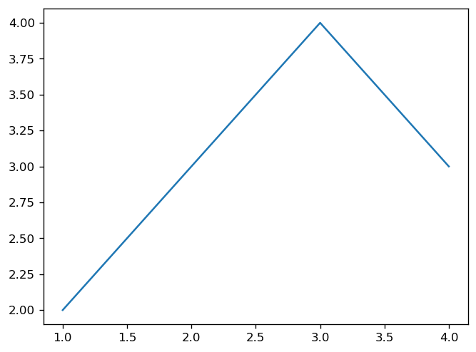
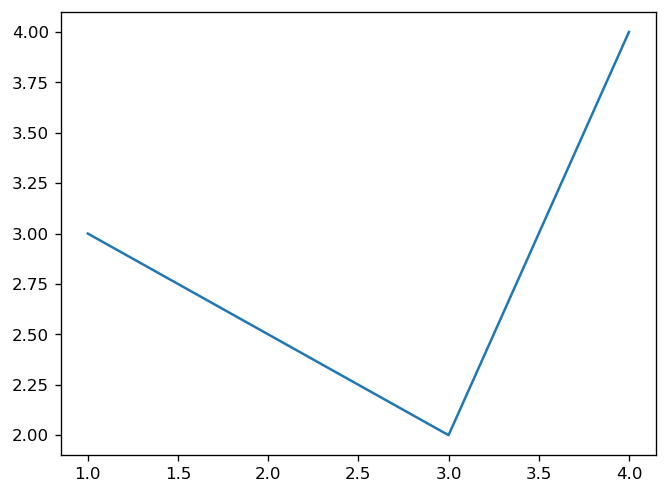
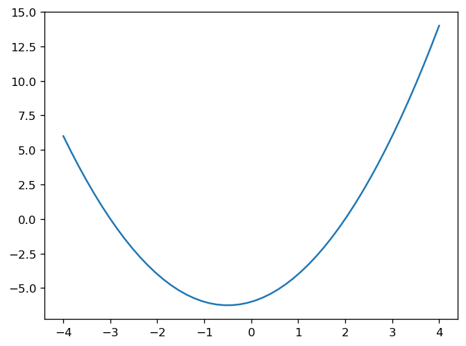
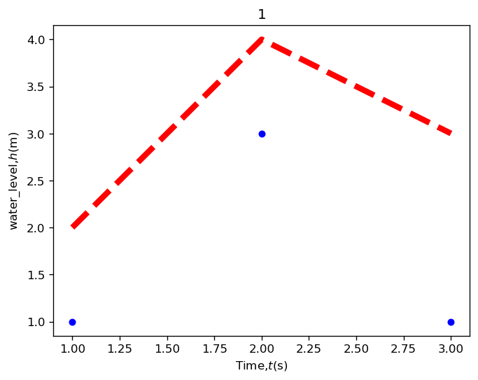
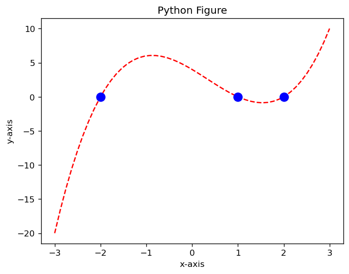

# 03. 二維幾何曲線、多項式與工程圖表樣式 (Data Visualization)

## 1. 研究目的與問題背景

工程實務高度依賴數據視覺化來傳達分析成果。無論是水庫水位的時間歷時監測、土壤沉陷量隨載重之變形曲線，或是結構分析中的受力多項式響應，圖表的視覺規範（線型、符號、標記大小、物理量符號與單位標註）直接影響判讀的準確性。

本單元之研究目的為：
1. 掌握 Matplotlib 的基礎繪圖機制，驗證座標點陣列維度一致性之要求。
2. 學習利用 `np.linspace` 產生均勻採樣之離散數值網格。
3. 實作非線性代數方程式（二次拋物線、三次多項式）之連續曲線描繪與特徵零根（Roots）之醒目標記。
4. 應用 LaTeX 數學語法於坐標軸標籤，建立符合土木水利工程規範的水位監測圖表。

---

## 2. 對應的原始 Python 程式碼

### 2.1 基礎離散折線繪製驗證 (`Cell 14, 15`)
```python
# 筆數一致性測試 A
plt.figure()
plt.plot([1, 3, 4], [2, 4, 3])  # x跟y的筆數要一致
plt.show()

# 筆數一致性測試 B
plt.figure()
plt.plot([1, 3, 4], [3, 2, 4])  # x跟y的筆數要一致
plt.show()
```

### 2.2 一維數值網格生成 (`Cell 16, 17`)
```python
x = np.linspace(-4, 4, 5)  # 建立網格(起點, 終點, 數量)
print(x)

x = np.linspace(-5, 2, 6)  # 建立網格(起點, 終點, 數量)
print(x)
```

### 2.3 連續二次多項式拋物線 (`Cell 18`)
```python
x = np.linspace(-4, 4, 50)
y = x**2 + x - 6
plt.figure()
plt.plot(x, y)
plt.show()
```

### 2.4 水位歷時監測工程圖表樣式 (`Cell 19`)
```python
plt.figure()
# plt.figure(figsize=(10,3)) # 圖形大小調整
plt.plot([1, 2, 3], [2, 4, 3], 'r--', linewidth=5)  # r是紅色--是虛線linewidth線寬度
plt.plot([1, 2, 3], [1, 3, 1], 'bo', markersize=5)  # b是藍的o試點markersize點大小
plt.xlabel('Time,$t$(s)')  # $會變斜體
plt.ylabel('water_level,$h$(m)')
plt.title("1")  # 圖表標題
plt.show()
```

### 2.5 三次多項式曲線與特徵零根標示 (`Cell 20`)
```python
x = np.linspace(-3, 3, 50)
y = (x + 2) * (x - 1) * (x - 2)
plt.figure()
plt.plot(x, y, 'r--')
plt.plot([-2, 1, 2], [0, 0, 0], 'bo', markersize=10)
plt.xlabel('x-axis')
plt.ylabel('y-axis')
plt.title('Python Figure')
plt.show()
```

---

## 3. 重要函式與參數說明

- `np.linspace(start, stop, num)`：在區間 `[start, stop]` 內產生 `num` 個等間距取樣點。間距為 $\Delta x = \frac{\text{stop} - \text{start}}{\text{num} - 1}$。
- `plt.plot(x, y, format_string, **kwargs)`：
  - `'r--'`：紅色（red）虛線（dashed line）。
  - `'bo'`：藍色（blue）實心圓形標記點（circle marker）。
  - `linewidth=5`：將線條粗細設定為 5 點，增強可視性。
  - `markersize=10`：將特徵標記點放大為直徑 10 點。
- `plt.xlabel('Time,$t$(s)')` 與 `plt.ylabel('water_level,$h$(m)')`：在標籤字串中夾入 `$t$` 與 `$h$`，Matplotlib 內建數學引擎會將其渲染為斜體數學變數符號。

---

## 4. 相關數學公式及推導

### 4.1 等間距網格公差計算
- 對於 `np.linspace(-4, 4, 5)`：
  $$\Delta x = \frac{4 - (-4)}{5 - 1} = \frac{8}{4} = 2.0 \implies x = \{-4, -2, 0, 2, 4\}$$
- 對於 `np.linspace(-5, 2, 6)`：
  $$\Delta x = \frac{2 - (-5)}{6 - 1} = \frac{7}{5} = 1.4 \implies x = \{-5.0, -3.6, -2.2, -0.8, 0.6, 2.0\}$$

### 4.2 二次多項式幾何特徵
$$y = x^2 + x - 6 = (x + 3)(x - 2)$$
- 零根（與 X 軸交點）：$x = -3$ 與 $x = 2$。
- 對稱軸與頂點（極小值）：
  $$x_v = -\frac{b}{2a} = -\frac{1}{2} = -0.5$$
  $$y_v = (-0.5)^2 + (-0.5) - 6 = 0.25 - 0.5 - 6 = -6.25$$

### 4.3 三次多項式分解與特徵根
$$y = (x + 2)(x - 1)(x - 2) = (x^2 - 4)(x - 1) = x^3 - x^2 - 4x + 4$$
- 函數的三個相異實根為：$x_1 = -2,\; x_2 = 1,\; x_3 = 2$。
- 在程式中，將這三點直接賦值為座標點數列：
  $$X_{\text{roots}} = [-2, 1, 2], \quad Y_{\text{roots}} = [0, 0, 0]$$
  並以 `plt.plot(X_{\text{roots}}, Y_{\text{roots}}, 'bo', markersize=10)` 於曲線上疊加醒目標示。

---

## 5. 實際執行結果

### 5.1 終端機網格數值輸出
- `Cell 16` 輸出：
  `[-4. -2.  0.  2.  4.]`
- `Cell 17` 輸出：
  `[-5.  -3.6 -2.2 -0.8  0.6  2. ]`

---

## 6. 對應圖表及圖表分析

### 6.1 基礎離散折線圖 A (`fig03.png`)

- **觀察**：三個點 $(1,2), (3,4), (4,3)$ 以實線相連，驗證離散資料繪圖之基本語法。

### 6.2 基礎離散折線圖 B (`fig04.png`)

- **觀察**：修改 Y 座標為 $(1,3), (3,2), (4,4)$，圖形呈現「先下降再上升」的 V 型折線。

### 6.3 二次拋物線曲線 (`fig05.png`)

- **觀察**：以 50 個採樣點平滑繪製 $y = x^2 + x - 6$。圖中清楚呈現開口向上、頂點位於 $(-0.5, -6.25)$ 之對稱幾何特徵，且在 $x = -3$ 與 $x = 2$ 處穿過 X 軸。

### 6.4 水位監測工程圖 (`fig06.png`)

- **觀察**：
  1. 上方粗紅虛線（`linewidth=5`）連接測站 1 至 3 的峰值水位變化（水位達 4 m）。
  2. 下方藍色圓形標記（`bo`）呈現基底參考水位。
  3. 坐標軸清楚標明物理量符號與單位：時間 $t\text{ (s)}$ 與水位 $h\text{ (m)}$，具備工程監測報表之基礎格式。

### 6.5 三次多項式與特徵根標示 (`fig07.png`)

- **觀察**：紅色虛線平滑呈現三次多項式之波峰與波谷。三個顯著的大型藍色圓點精準落於 $y=0$ 軸線上，直觀凸顯多項式代數解與幾何圖形之交點關係。

---

## 7. 工程應用意義

1. **水文與防洪工程水位歷時曲線（Stage-Hydrograph）**：土木水利工程中，流量觀測站藉由定時回傳之感測器訊號繪製水歷時圖，線條粗細與標記點能有效區隔「警報水位」、「堤防高程」與「實測水位」。
2. **結構零彎矩點（Inflection Points）與平衡點定位**：樑構件在連續跨載重下，其撓度多項式或彎矩方程式之特徵反彎點（Moment inflection points, 即方程式零根）位置，是鋼筋混凝土構件配置剪力鋼筋與接頭錨定的關鍵依據。

---

## 8. 原始資料出處

- **來源檔案**：`RAW/W03/main.ipynb` (Cell 14–20) 與 `RAW/W03/main.py` (行 95–139)
- **原始註解**：`#x跟y的筆數要一致`、`#建立網格(起點,終點,數量)`、`#r是紅色--是虛線linewidth線寬度`
