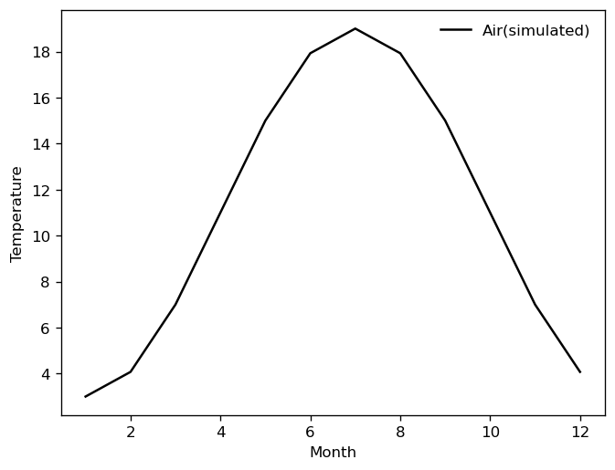
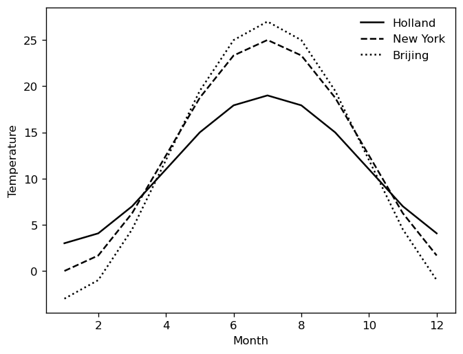
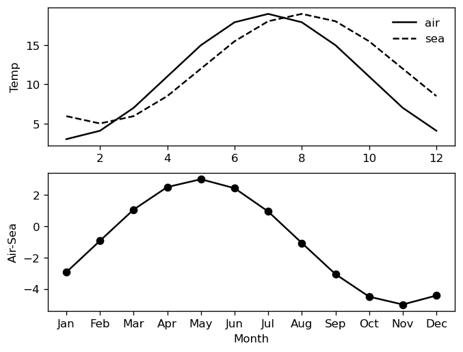

# 04. 週期性氣候模型與氣海溫差雙子圖 (Climate Simulation & Subplots)

## 1. 研究目的與問題背景

在土木與環境工程中，大型基礎設施（如跨海大橋、大跨度鋼構屋頂、水庫大壩與核能電廠冷卻池）長期暴露於大氣與水體環境中。環境溫度之年週期變化會引起嚴重的結構熱脹冷縮（Thermal expansion/contraction）與熱應力。海洋與大氣的比熱容差異（海洋熱容量大、升溫慢）造成海溫高峰相較於氣溫產生明顯之相位滯後（Phase lag）。

本單元之研究目的為：
1. 建立以一階餘弦諧波（Cosine Harmonic）模擬年氣溫週期變化之數學模型。
2. 比較海洋性氣候與大陸性氣候城市之年平均溫與極端溫差振幅。
3. 實作多層次雙子圖（Subplot）排版技術，結合文字刻度轉換（自訂英文月份標籤），展示氣海熱力學差異。

---

## 2. 對應的原始 Python 程式碼

### 2.1 荷蘭模擬年氣溫曲線 (`Cell 21`)
```python
month = np.arange(1, 13)
air = 11 + 8 * np.cos(2 * np.pi * (month - 7) / 12)
print(air.round(1))
# 一月3.0#七月19.0
# 年平均溫度=11 振幅=8 最熱的月份=7
plt.figure()
plt.plot(month, air, 'k-', label='Air(simulated)')
plt.legend(frameon=False)  # frameon=False不要外框
plt.xlabel('Month')
plt.ylabel('Temperature')
plt.show()
```

### 2.2 三大城市氣候對比 (`Cell 22`)
```python
month = np.arange(1, 13)
holland = 11 + 8 * np.cos(2 * np.pi * (month - 7) / 12)
newyork = 12.5 + 12.5 * np.cos(2 * np.pi * (month - 7) / 12)
brijing = 12 + 15 * np.cos(2 * np.pi * (month - 7) / 12)

plt.figure()
plt.plot(month, holland, 'k-', label='Holland')
plt.plot(month, newyork, 'k--', label='New York')
plt.plot(month, brijing, 'k:', label='Brijing')
plt.legend(frameon=False)  # frameon=False不要外框
plt.xlabel('Month')
plt.ylabel('Temperature')
plt.show()
```

### 2.3 氣溫海溫與氣海溫差雙子圖 (`Cell 23`)
```python
months = ['Jan', 'Feb', 'Mar', 'Apr', 'May', 'Jun', 'Jul', 'Aug', 'Sep', 'Oct', 'Nov', 'Dec']
month = np.arange(1, 13)
sea = 12 + 7 * np.cos(2 * np.pi * (month - 8) / 12)
air = 11 + 8 * np.cos(2 * np.pi * (month - 7) / 12)
name = air - sea

plt.figure()
plt.subplot(2, 1, 1)  # 在上圖畫曲線
plt.plot(month, air, 'k-', label='air')
plt.plot(month, sea, 'k--', label='sea')
plt.legend(frameon=False)  # frameon=False不要外框
plt.ylabel('Temp')

plt.subplot(2, 1, 2)  # 在下圖畫曲線
plt.plot(month, name, 'k-')  # k是黑色
plt.plot(month, name, 'ko')
plt.xticks(month, months)  # 自訂x軸的刻度與標籤
plt.xlabel('Month')
plt.ylabel('Air-Sea')
```

---

## 3. 重要函式與參數說明

- `np.arange(1, 13)`：產生整數陣列 `[1, 2, ..., 12]`，代表 1 月至 12 月。
- `plt.subplot(nrows, ncols, index)`：將繪圖畫布分割為 $2 \times 1$ 的矩陣區塊。`index=1` 操作上子圖，`index=2` 操作下子圖。
- `plt.xticks(ticks, labels)`：將 X 軸數值刻度（1 至 12）替換為自訂英文月份縮寫字串（`['Jan', ..., 'Dec']`），提升圖表之易讀性。
- `plt.legend(frameon=False)`：關閉圖例方框背景與邊界線，呈現簡潔俐落之出版品視覺風格。
- 灰階線型代號：`'k-'`（黑色實線）、`'k--'`（黑色虛線）、`'k:'`（黑色點線）、`'ko'`（黑色圓點標記）。

---

## 4. 相關數學公式及推導

### 4.1 年度諧波氣候公式模型
$$T(m) = \bar{T} + A \cos\left( \frac{2\pi (m - m_{\text{peak}})}{12} \right)$$
其中：
- $\bar{T}$ 為年平均溫度（Mean temperature，基線）。
- $A$ 為溫度振幅（Amplitude，最高溫與最低溫之半差）。
- $m_{\text{peak}}$ 為全年最熱月份（Peak month）。
- 週期固定為 12 個月，故角頻率為 $\omega = \frac{2\pi}{12} = \frac{\pi}{6}\text{ rad/month}$。

### 4.2 三城市模型參數解析
| 地點 | 年平均溫 $\bar{T}$ ($^\circ\text{C}$) | 振幅 $A$ ($^\circ\text{C}$) | 最高月 $m_{\text{peak}}$ | 最高溫 $T_{\max}$ | 最低溫 $T_{\min}$ | 年溫差 $\Delta T_{\text{annual}}$ | 氣候型態特徵 |
| :--- | :---: | :---: | :---: | :---: | :---: | :---: | :--- |
| **荷蘭 (Holland)** | 11.0 | 8.0 | 7月 (July) | $19.0^\circ\text{C}$ | $3.0^\circ\text{C}$ | $16.0^\circ\text{C}$ | 溫帶海洋性氣候（溫差最小、夏涼冬溫） |
| **紐約 (New York)** | 12.5 | 12.5 | 7月 (July) | $25.0^\circ\text{C}$ | $0.0^\circ\text{C}$ | $25.0^\circ\text{C}$ | 大陸性混合氣候（四季分明、溫差適中） |
| **北京 (Beijing)** | 12.0 | 15.0 | 7月 (July) | $27.0^\circ\text{C}$ | $-3.0^\circ\text{C}$ | $30.0^\circ\text{C}$ | 典型溫帶大陸季風氣候（年溫差高達 $30^\circ\text{C}$） |

### 4.3 氣海溫差熱滯後效應分析
大氣升溫迅速，其峰值出現在 7 月（$m_{\text{peak}} = 7$）：
$$T_{\text{air}}(m) = 11 + 8 \cos\left( \frac{2\pi (m - 7)}{12} \right)$$
海水因具備高熱容量與垂直混合效應，其最高溫延遲一個月出現在 8 月（$m_{\text{peak}} = 8$），振幅較小（$A=7$）：
$$T_{\text{sea}}(m) = 12 + 7 \cos\left( \frac{2\pi (m - 8)}{12} \right)$$
氣海溫差（$\text{Air} - \text{Sea}$）：
$$\Delta T(m) = T_{\text{air}}(m) - T_{\text{sea}}(m)$$
- 在春夏（4～6月），大氣升溫速率遠快於海水，$\Delta T > 0$（氣溫高於海溫）。
- 在秋冬（9～1月），大氣迅速冷卻，但海水持續釋放蓄積熱量，$\Delta T < 0$（氣溫低於海溫，海水扮演保溫調節器）。

---

## 5. 實際執行結果

### 5.1 荷蘭各月份模擬氣溫數值輸出 (`Cell 21`)
程式執行 `air.round(1)` 輸出之 12 個月份平均溫數列（單位：$^\circ\text{C}$）：
```text
[ 3.   4.1  7.  11.  15.  17.9 19.  17.9 15.  11.   7.   4.1]
```
- 1 月（$m=1$）：$11 + 8\cos(-\pi) = 11 - 8 = 3.0^\circ\text{C}$（全年最低）
- 7 月（$m=7$）：$11 + 8\cos(0) = 11 + 8 = 19.0^\circ\text{C}$（全年最高）
- 4 月與 10 月：$11 + 8\cos(\pm \pi/2) = 11.0^\circ\text{C}$（等於年均溫）

---

## 6. 對應圖表及圖表分析

### 6.1 荷蘭年氣溫曲線圖 (`fig08.png`)

- **觀察**：單一實線繪製荷蘭氣溫變化，圖例不帶外框（`frameon=False`），呈現平滑對稱的單峰年循環曲線。

### 6.2 三大城市氣候曲線多線型對比圖 (`fig09.png`)

- **觀察**：
  1. 荷蘭（實線）曲線平緩，波谷高於 $0^\circ\text{C}$，展現受北大西洋暖流調節之溫和氣候特徵。
  2. 紐約（虛線）與北京（點線）曲線震幅顯著放大，北京在冬季 1 月降至零下（$-3^\circ\text{C}$），夏季則逼近 $27^\circ\text{C}$，鮮明呈現大陸性氣候的極端溫差。
  3. 三條曲線皆採用純黑線條搭配相異線型（實線、虛線、點線），即使以黑白列印論文亦能精確辨識。

### 6.3 氣溫、海溫與氣海溫差雙子圖 (`fig10.png`)

- **觀察**：
  1. 上圖（`Temp`）：實線（氣溫）於 7 月達頂點，虛線（海溫）頂點向右平移至 8 月，直觀體現海洋熱滯後 1 個月之物理機制。
  2. 下圖（`Air-Sea`）：折線搭配圓圈點標記，X 軸標註英文月份（`Jan` 至 `Dec`）。5～7 月溫差為正且達到峰值；秋末與初冬溫差轉為顯著負值，精確刻畫了海洋對沿海陸地氣候的調節循環。

---

## 7. 工程應用意義

1. **大跨徑橋樑伸縮縫（Expansion Joints）設計**：橋樑主樑長度隨溫度變化之伸縮量公式為 $\Delta L = \alpha_T \cdot L \cdot \Delta T$。在北京等年溫差高達 $30^\circ\text{C}$ 且需考量極端晝夜溫差之大陸地區，伸縮縫選型與防夾死預留量遠大於海洋性氣候地區。
2. **巨積混凝土（Mass Concrete）溫度應力控制**：在大壩或高樓厚大基礎澆置時，外界環境氣溫突降會使混凝土表面迅速冷卻收縮，而內部水化熱不易散失，內外極大溫差引發之表面拉應力是導致貫穿性裂縫（Thermal Cracking）之主因。

---

## 8. 原始資料出處

- **來源檔案**：`RAW/W03/main.ipynb` (Cell 21–23) 與 `RAW/W03/main.py` (行 141–184)
- **原始註解**：`#一月3.0#七月19.0`、`#年平均溫度=11 振幅=8 最熱的月份=7`、`#在上圖畫曲線`、`#自訂x軸的刻度與標籤`
